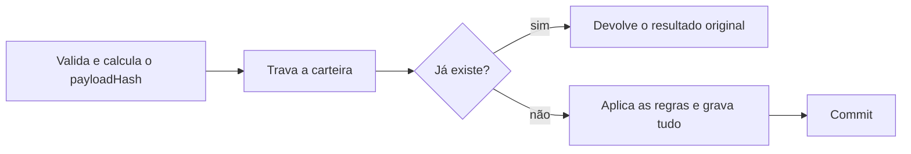

# Arquitetura
 
Este documento explica como o projeto funciona e por que as decisões foram tomadas. Para rodar o projeto, veja o [README](./README.md).
 
---
 
## 1. Visão geral
 
A API recebe transações de aposta por HTTP ou por uma fila SQS, aplica o efeito no saldo da carteira e registra cada movimento num ledger, que é uma lista de lançamentos que nunca é alterada. Cada resultado também vira um evento, que sai para uma segunda fila.
 
Três ideias guiam o projeto.
 
- **A verdade fica no PostgreSQL.** A aplicação não guarda estado importante em memória. Qualquer instância atende qualquer pedido, e uma instância pode morrer a qualquer momento sem deixar nada pela metade. Quem coordena as instâncias é o banco, com locks, índices únicos e constraints.
- **Uma operação de negócio é uma transação do banco.** Saldo, lançamento no ledger, transação recebida e eventos são gravados juntos. Ou tudo é confirmado, ou nada é.
- **Repetição não pode virar efeito duplicado.** A mesma requisição ou mensagem pode chegar mais de uma vez. O sistema reconhece a repetição e não aplica de novo, então o saldo muda uma vez só.
O código é dividido em módulos, e cada um segue as camadas `domain` (regras e interfaces), `application` (casos de uso) e `infra` (TypeORM e SQS). O `domain` não depende de framework nem de banco. O `wagering` está aberto abaixo como exemplo, e o mesmo desenho vale para `wallet`, `outbox` e `inbox`, cada um só com as pastas de que precisa.
 
```
.
├── src/
│   ├── wagering/                processa as transações
│   │   ├── domain/              entidade, regras e interfaces
│   │   ├── application/         casos de uso
│   │   ├── infra/               repositórios com TypeORM
│   │   ├── http/                controllers, a porta de entrada da API
│   │   ├── messaging/           consumidor e worker da fila SQS
│   │   ├── events/              eventos publicados
│   │   └── wagering.module.ts
│   ├── wallet/                  carteira, ledger e reconciliação
│   ├── outbox/                  publicação dos eventos no SQS
│   ├── inbox/                   registro de mensagens já recebidas
│   ├── shared/                  Money, erros, migrations, logs e guard
│   ├── health/                  /health/live e /health/ready
│   └── metrics/                 /metrics no formato Prometheus
├── test/                        integração, concorrência e queda de processo
├── docker/                      configuração do Nginx
└── localstack/                  script que cria as filas
```
 
O controller é a porta de entrada HTTP e não tem regra de negócio. Ele lê o corpo e o header `Idempotency-Key`, valida a entrada, chama o caso de uso e converte o resultado em status HTTP. A fila SQS chega no mesmo caso de uso, por isso HTTP e fila dão o mesmo resultado.
 
## 2. ORM e isolamento do domínio
 
O domínio não conhece o TypeORM. As entidades (`WagerTransaction`, `Wallet`, `Money`) são classes comuns, sem decorators do ORM. Os repositórios são declarados no domínio como classes abstratas e implementados na camada `infra`.
 
O motivo técnico é que as regras de negócio ficam nessas classes, e assim elas podem ser testadas sozinhas, sem subir o banco. Também ajuda o fato de que as garantias mais importantes do projeto (índices únicos, `CHECK`, triggers e `FOR UPDATE`) estão no banco e em SQL direto, e não no ORM. Trocar de ORM mudaria só a camada `infra`. O custo é que o mapeamento entre a entidade de domínio e a do ORM é manual.
 
Usei **TypeORM** porque o enunciado prefere MikroORM mas aceita TypeORM, e eu já conhecia melhor. Como o ORM faz pouco neste projeto, preferi gastar o tempo nos módulos que mais pesam no desafio do que aprendem uma técnologia nova em tão pouco tempo.
 
## 3. Mapeamento do dinheiro
 
Dinheiro nunca é `number`.
 
| Camada | Como o valor aparece |
|---|---|
| HTTP, fila e eventos | String com até 2 casas, como `"25.00"` |
| Domínio | Classe `Money`, que usa `decimal.js` |
| PostgreSQL | `NUMERIC(19,2)` |
 
O driver `pg` devolve `NUMERIC` como string, então o valor nunca passa por ponto flutuante. A classe `Money` só soma ou subtrai valores da mesma moeda.
 
## 4. Banco de dados
 
| Tabela | O que guarda |
|---|---|
| `wallets` | Uma carteira por jogador e moeda, com o saldo e a `version` |
| `wager_transactions` | Cada transação recebida, com status, `payload_hash` e referência |
| `wallet_ledger_entries` | Os lançamentos de débito e crédito, que nunca mudam |
| `outbox_events` | Os eventos esperando publicação |
| `inbox_messages` | As mensagens da fila que já foram tratadas |
 
O próprio schema impõe estas garantias, sem depender do código.
 
- Saldo nunca negativo, com `CHECK (balance >= 0)`.
- Uma carteira por jogador e moeda.
- Idempotência, com `UNIQUE (provider_id, idempotency_key)` e `UNIQUE (provider_id, external_transaction_id)`.
- Um lançamento por transação, com `UNIQUE (wallet_id, transaction_id)` no ledger.
- Ledger imutável, com um trigger que bloqueia `UPDATE` e `DELETE`.
- Transação concluída não muda mais, também por trigger.
- Uma reversão de cada tipo por referência, com índice único parcial.
O invariante que os testes conferem o tempo todo é que o **saldo da carteira é igual à soma do ledger**. A rota `POST /wallets/:id/reconciliation` faz essa conta com um único SQL.
 
## 5. Fluxo de uma transação
 

 
1. **Entrada.** No HTTP, o controller lê o corpo e o header `Idempotency-Key`, que é obrigatório (`400` se faltar). Na fila, o consumidor lê a mensagem. O conteúdo é validado e o `payloadHash` é calculado antes de abrir a transação do banco, então uma entrada inválida nunca toca o banco.
2. **Trava a carteira.** A primeira coisa dentro da transação é o `SELECT ... FOR UPDATE` na carteira. Quem chegar depois para a mesma carteira espera. Isso vem antes de checar a idempotência de propósito. Se duas chamadas iguais chegam juntas, a segunda espera a primeira terminar e, quando entra, já enxerga o que a primeira gravou.
3. **Confere se já existe.** O sistema procura uma transação com a mesma chave de idempotência ou o mesmo id externo. Se achou com o mesmo conteúdo, devolve o resultado original sem tocar em nada, o que chamo de replay. Se achou com conteúdo diferente, responde `409`.
4. **Aplica as regras.** Confere se o jogador é o dono da carteira, se a moeda bate, se a referência é válida (para `REFUND` e `ROLLBACK`) e se o saldo cobre o débito. O resultado é `PROCESSED`, `REJECTED` ou `PENDING_REFERENCE`. Saldo insuficiente não é erro, é uma transação `REJECTED` que também é gravada.
5. **Grava.** Insere a transação, grava o lançamento no ledger, atualiza o saldo e grava os eventos no outbox, tudo no mesmo commit. O `UPDATE` do saldo só vale se a `version` ainda for a que foi lida.
6. **Responde.** Só depois do commit. No HTTP, o status é `200` para processada, `202` para pendente e `422` para rejeitada. Na fila, o ack também vem depois do commit (seção 9).
## 6. Como o sistema evita duplicidade
 
| Onde a duplicidade aparece | Defesa |
|---|---|
| O cliente repete a mesma chamada | Idempotência gravada no banco, com replay do resultado |
| Duas chamadas iguais ao mesmo tempo | Lock da carteira, e a segunda lê o registro da primeira |
| A mesma mensagem chega duas vezes pela fila | Inbox, gravado junto com o efeito |
| O mesmo débito entra duas vezes no ledger | `UNIQUE (wallet_id, transaction_id)` |
| Uma aposta é devolvida duas vezes | Índice único parcial de reversão |
| O mesmo evento é publicado duas vezes | Aceito, e quem consome descarta pelo `eventId` |
 
Se duas chamadas idênticas disputam a carteira, a primeira cria a transação e dá commit. A segunda, ao conseguir o lock, relê o banco, encontra o registro e devolve o replay. Os índices únicos são a última barreira, e nesse caso o banco recusaria a duplicata.
 
A garantia é contra a repetição da **mesma** transação, com o mesmo id. O sistema não sabe se duas transações diferentes representam o mesmo fato na vida real. Isso depende do cliente ou de conciliação, como descrito na seção 16.

## 7. Concorrência

O projeto usa os dois tipos de controle, cada um num momento diferente da mesma transação.

1. **Lock pessimista é o principal.** O `SELECT ... FOR UPDATE` trava a carteira como primeiro passo. Quem chega depois para a mesma carteira espera. Carteiras diferentes não se bloqueiam, então não existe lock global.
2. **Controle otimista com `version`, a verificação extra.** Na hora de gravar, o `UPDATE` do saldo só vale se a `version` ainda for a que foi lida. A versão sobe por um trigger, só quando o saldo muda. Com o lock funcionando, essa conferência nunca deveria falhar. Ela existe para o caso de algum caminho esquecer o lock, e então o resultado é um erro, e não um saldo corrompido.
3. **Índices únicos, a última barreira.** Se tudo falhasse, o banco recusaria a duplicata.

Usei o lock pessimista como principal, e não o otimista sozinho com retry, porque numa carteira muito usada o otimista faria várias transações rodarem o trabalho inteiro e a maioria falharia na hora de gravar, para tentar de novo. Com o lock, cada transação roda uma vez e em ordem. O custo é que as apostas da mesma carteira andam uma por vez, o que é o comportamento correto para um saldo.

**Timeouts.** Toda conexão abre com `lock_timeout` de 5 s, `statement_timeout` de 15 s e `idle_in_transaction_session_timeout` de 30 s. Sem eles, uma carteira presa seguraria conexões até a API parar. Quando um estoura, ou acontece deadlock, o HTTP responde `503` com `Retry-After`, e a mensagem da fila volta com espera. Repetir é seguro.

**Várias instâncias.** A correção não depende de existir uma instância só, porque quem coordena é o banco. O Docker Compose sobe 3 réplicas, e cada uma roda a API e os workers.
 
## 8. Idempotência e `payloadHash`
 
A idempotência fica no banco, então sobrevive a reinício e funciona entre instâncias.
 
- A chave é o par `(provider_id, idempotency_key)`. Na fila, se a mensagem não traz chave, o sistema usa `providerId:externalTransactionId`.
- Junto com a transação fica o `payload_hash`, uma impressão digital do conteúdo. Mesma chave e mesmo hash devolvem o resultado original com `idempotentReplay: true`. Mesma chave com hash diferente é `409 IDEMPOTENCY_CONFLICT`. O mesmo `externalTransactionId` com conteúdo diferente também é conflito.
- Uma rejeição também é repetida igual, porque foi gravada.
O hash é calculado assim. O sistema pega só os campos de negócio, monta um JSON com as chaves ordenadas e calcula o SHA-256. A ordem das chaves, os espaços e campos extras não mudam o hash.
 
A chave e o `externalTransactionId` vêm de quem chama a API, que é o backend do provedor. O servidor não gera esses valores, porque se gerasse, cada tentativa ganharia uma chave nova e ele nunca reconheceria uma repetição.
 
## 9. Fila, inbox e outbox
 
### Fila SQS
 
A fila de transações é FIFO, e o `MessageGroupId` é a carteira. Isso mantém a ordem das mensagens da mesma carteira e deixa carteiras diferentes andarem em paralelo.

Para cada mensagem, o worker faz tudo dentro de uma transação do banco. Primeiro registra a mensagem no inbox, depois processa a transação e dá commit. Só então envia o ack, que é a confirmação ao SQS de que a mensagem foi tratada e pode ser apagada da fila. Sem o ack, o SQS entrega a mensagem de novo. Por isso o ack vem depois do commit. Se o processo morrer antes do commit, nada foi gravado e a mensagem volta inteira. Se morrer depois do commit e antes do ack, a mensagem volta, mas o inbox mostra que ela já foi tratada.
 

 
| Situação | O que acontece |
|---|---|
| Regra de negócio falha, como saldo insuficiente | A transação vira `REJECTED`, é gravada e a mensagem recebe o ack |
| Carteira inexistente ou conflito de idempotência | A mensagem recebe o ack, e o erro fica no log |
| Mensagem inválida, como JSON quebrado ou campo faltando | Vai para a DLQ e recebe o ack |
| Erro temporário, como banco ocupado | A mensagem volta com espera que cresce, de `5 s × 2^(n−1)` até 5 minutos |
| Muitas entregas sem sucesso | O SQS manda para a DLQ depois de 5 recebimentos |
 
A DLQ é uma fila à parte, onde ficam as mensagens que não puderam ser processadas, para alguém investigar.
 
### Inbox
 
O inbox é uma tabela que anota as mensagens já tratadas. A chave é `(consumer_name, message_id)`. Ao receber uma mensagem, o consumidor tenta inserir o id dela nessa tabela. Se o id já estava lá, a mensagem é repetida e é descartada.
 
O detalhe importante é que essa inserção acontece **na mesma transação que muda o saldo**, ou seja, vai no mesmo commit. Então os dois existem ou nenhum existe. Se a transação é confirmada, o saldo mudou e a mensagem está anotada como tratada. Se é desfeita, nada mudou e nada foi anotado, e a mensagem pode ser reprocessada sem problema. Nunca sobra uma mensagem anotada como tratada sem o efeito dela.
 
### Outbox
 
Gravar no banco e publicar numa fila são operações em dois sistemas, e não existe transação que cubra os dois. Se o sistema grava e cai antes de publicar, o evento se perde. Se publica e cai antes de gravar, sai um evento de algo que não aconteceu.
 
O outbox resolve isso. Em vez de publicar direto, o sistema grava o evento na tabela `outbox_events`, no mesmo commit que muda o saldo. Depois, um worker lê os eventos pendentes, publica no SQS e marca como publicados. Se a publicação falhar, o evento continua pendente e é tentado de novo, com espera que cresce de `1 s × 2^(n−1)` até 5 minutos. Vários workers não pegam a mesma linha por causa do `FOR UPDATE SKIP LOCKED`.
 
A entrega é **pelo menos uma vez**. Se o worker cair depois de enviar e antes de marcar, outro publica de novo, e a fila de eventos recebe dois exemplares. Ela é uma fila padrão, que não deduplica. Por isso todo evento tem um `eventId` fixo, o mesmo id da linha do outbox, para quem consome descartar duplicados. O saldo e o ledger não são afetados. O contrário nunca acontece, porque o evento só passa a existir junto com o commit.
 
Eventos gerados são `WagerTransactionProcessed`, `WagerTransactionRejected`, `WagerTransactionPendingReference` e `WalletBalanceChanged`.
 
O worker publica com a transação do banco aberta. É uma troca consciente. O lote é de 10 eventos, cada envio tem limite de 5 segundos e a transação só segura as linhas do lote. O custo é uma conexão do pool ocupada durante a chamada de rede.
 
### Diferenças em relação ao enunciado
 
O enunciado descreve `InboxMessage` com `payloadHash` e `processedAt`, e `OutboxMessage` com métodos como `scheduleRetry`. Fiz de outra forma.
 
- O inbox não guarda `payloadHash` nem `processedAt`. Como o registro nasce junto com o efeito, a existência da linha já significa que a mensagem foi processada, e um `processedAt` seria igual ao `received_at`. O conflito de conteúdo já é resolvido no `payload_hash` da transação.
- Inbox e outbox são tabelas com interfaces de repositório, e não classes de domínio com métodos. A lógica de retry está no serviço do publicador.
### Falhas e recuperação
 
| Quando a falha acontece | O que acontece |
|---|---|
| O processo morre antes do commit | O banco desfaz tudo, e a chamada pode ser repetida |
| Morre depois do commit, antes de responder o HTTP | O cliente repete com a mesma chave e recebe o replay |
| Morre depois do commit, antes do ack da fila | A mensagem volta e o inbox mostra que já foi tratada |
| O banco está ocupado | `503` com `Retry-After`, ou a mensagem volta com espera |
| A fila de eventos está fora do ar | O evento fica pendente e é tentado de novo, e o saldo não é afetado |
| Uma conexão fica parada dentro de uma transação | O timeout derruba a conexão e libera os locks |
 
A regra que sustenta tudo é que o commit é o único ponto de decisão. Antes dele nada existe, e depois dele tudo existe. O que vem depois, como o ack e a publicação do evento, pode ser repetido sem prejuízo.
 
## 10. Estados e referências fora de ordem
 
| De | Para | Quando |
|---|---|---|
| (nova) | `PROCESSED` | Aplicada com sucesso |
| (nova) | `REJECTED` | Alguma regra falhou |
| (nova) | `PENDING_REFERENCE` | `REFUND` ou `ROLLBACK` cuja referência ainda não existe |
| `PENDING_REFERENCE` | `PROCESSED` | A referência apareceu |
| `PENDING_REFERENCE` | `REJECTED` | A referência é inválida ou as tentativas acabaram |
 
`PROCESSED` e `REJECTED` são finais, e o trigger do banco não deixa alterar.
 
`REFUND` e `ROLLBACK` podem chegar **antes** da transação que referenciam, porque mensagens fora de ordem são normais numa fila. Em vez de rejeitar na hora, a transação fica `PENDING_REFERENCE` e o HTTP responde `202`. Um worker tenta de novo, com até 8 tentativas e espera crescente (5, 10, 20, 40, 80, 160, 300 e 300 segundos), o que dá uns 15 minutos. Se a referência aparecer, a transação é processada. Se não, vira `REJECTED`. Vários workers podem pegar a mesma pendente, e quem resolve é o lock da carteira, porque cada um relê a transação depois de travar e pula se já foi resolvida.
 
## 11. Regras de negócio e interpretações
 
| Tipo | Efeito |
|---|---|
| `BET` | Débito |
| `WIN` | Crédito |
| `LOSS` | Nenhum, vira `PROCESSED` sem lançamento no ledger |
| `REFUND` | Crédito, devolvendo uma `BET` |
| `ROLLBACK` | Desfaz o lançamento da referência |
 
Quando uma transação é rejeitada, o `failureCode` diz o motivo, como `INSUFFICIENT_FUNDS`, `WALLET_PLAYER_MISMATCH`, `CURRENCY_MISMATCH`, `REFERENCE_NOT_FOUND` e `ALREADY_REVERSED`.
 
**Interpretações que fiz onde o enunciado deixa espaço.**
 
- `Idempotency-Key` é obrigatório no HTTP. O padrão `providerId:externalTransactionId` só vale na fila, que não tem header.
- Reembolso e rollback exigem o mesmo valor da referência, sem reembolso parcial, e cada tipo de reversão só vale uma vez por referência.
- Abrir uma carteira com saldo inicial registra uma transação `OPENING` com um crédito no ledger, para o saldo bater com o ledger desde o início.
- Uma carteira tem uma moeda só, e a transação precisa ser da mesma moeda.
- No outbox, a coluna se chama `transaction_id` e não `aggregate_id`, porque o agregado dos eventos é a própria transação.
## 12. Status HTTP
 
| Status | Quando |
|---|---|
| `200` | Transação processada, ou repetida com o mesmo resultado |
| `201` | Carteira criada |
| `202` | Transação pendente de referência |
| `400` | Payload inválido ou falta o `Idempotency-Key` |
| `404` | Carteira ou transação não encontrada |
| `409` | Conflito de idempotência ou carteira já existente |
| `422` | Transação rejeitada por regra de negócio |
| `503` | Banco ocupado, e repetir é seguro |
 
## 13. Autenticação
 
**Não implementei autenticação**, como o enunciado permite. Foquei na consistência financeira, e uma autenticação feita pela metade seria pior do que uma bem documentada mas não implementada.
 
O ponto de extensão existe. Toda rota passa por um `AuthGuard` global (`src/shared/http/auth.guard.ts`), que hoje libera tudo, e as rotas de saúde e métricas são marcadas com `@Public()`. Em produção eu validaria um token JWT de um provedor de identidade, conferindo assinatura, emissor e validade, e cruzaria o provedor do token com o `providerId` da transação, para um provedor não mexer em transações de outro. Bastaria implementar o método `isAuthenticated` do guard.
 
## 14. Observabilidade
 
- **Logs em JSON** com `correlationId`, que acompanha o processamento inteiro, inclusive os eventos publicados.
- **`/health/live`** indica que o processo está de pé, e **`/health/ready`** indica que o PostgreSQL e o SQS respondem.
- **`/metrics`**, no formato Prometheus, com transações por status, duplicatas detectadas, retries, mensagens na DLQ, eventos publicados, latência e o lag do outbox.
## 15. Testes
 
Os testes de integração usam **PostgreSQL e SQS de verdade**, sem mock no lugar deles.
 
- **Unitários** cobrem dinheiro, regras da transação, hash, guard e métricas.
- **Integração** cobre fluxos completos, constraints e triggers do schema, outbox, inbox, referências pendentes e HTTP.
- **Concorrência** cobre 50 chamadas idênticas, duas apostas de 80 com saldo 100 e várias instâncias disputando a mesma aposta.
- **Processos reais** sobem 3 instâncias de verdade, com carteira quente (150 apostas de 1,00 com saldo 100 aceitam exatamente 100) e carteira presa virando `503`.
- **Falhas** matam todos os processos com `SIGKILL` e `SIGTERM` no meio do tráfego, e cobrem commit sem ack e publicador morto no meio do lote.
Depois de cada cenário, os testes conferem que o saldo é igual ao ledger, que nada foi debitado duas vezes e que a DLQ está vazia.
 
## 16. Limitações e o que ficou de fora
 
- **Sem autenticação real.** Existe só o ponto de extensão, descrito na seção 13.
- **O sistema confia no provedor quanto ao conteúdo.** Ele impede repetir a mesma transação, mas não sabe se duas transações diferentes representam o mesmo fato. Isso depende de autenticação, conciliação com o provedor e limites, que não estão implementados.
- **Inbox e outbox sem classes de domínio**, e o inbox sem `payloadHash` e `processedAt`, como explicado na seção 9.
- **Métricas em memória.** Zeram ao reiniciar, e cada instância conta só as suas.
- **Sem proteções de produção.** Não há limite de tamanho do corpo nem rate limit, e as tabelas `outbox_events` e `inbox_messages` não têm limpeza automática.
